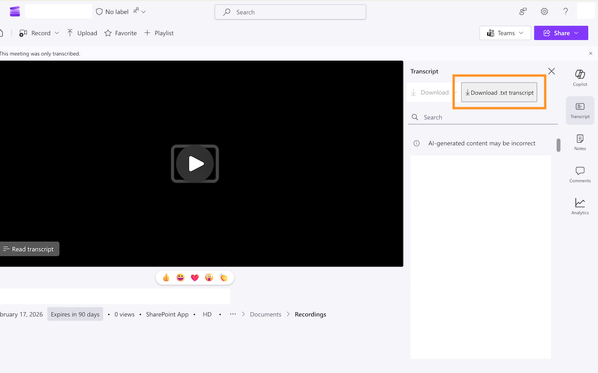

# Teams Transcript Auto-Downloader

Browser extension for Chrome and Safari on macOS that downloads meeting transcripts from SharePoint-hosted Teams recordings and Teams meeting recaps.



## Features

- Adds SharePoint recording URLs to a queue
- Processes queue items in the background
- Downloads transcript text files via authenticated browser session
- Tracks history to prevent duplicate downloads (unless explicitly allowed)
- Supports manual "download from current page" via extension action
- Adds a **Download .txt transcript** button to the transcript tab of Teams web meeting recaps

## Project Structure

- `extension/src/`: main extension source (background, content, UI, shared utils)
- `extension/manifest.json`: canonical extension manifest
- `scripts/test.js`: lightweight Node test script for core utilities
- `extension/`: source and distribution directory (`manifest.json` at folder root)

## Requirements

- Node.js 18+ (or compatible modern Node runtime)
- Google Chrome (or a Chromium-based browser with MV3 support), or Safari 16.4 or later on macOS 12 or later

## Install Dependencies

This project currently has no runtime npm dependencies, but install metadata and tooling with:

```bash
npm install
```

## Run Tests

```bash
npm test
```

## Release Commands

Use the `Makefile` targets for consistent versioning and packaging:

```bash
# bump patch version across extension/manifest.json and package.json
make version

# or set a specific version
make version VERSION=0.2.0

# build distribution zip (fails if versions are out of sync)
make dist
```

For a versioned branch, set `VERSION` to the branch version before packaging. The archive name uses the manifest version; renaming an archive does not update its contents.

## Load Extension Locally

1. Open `chrome://extensions`.
2. Enable **Developer mode**.
3. Click **Load unpacked**.
4. Select `/Users/chris.patten/workspace/transcript_downloader/extension`.

## Package for Distribution

Run `make dist` from the repo root. It creates:

- `dist/teams-transcript-auto-downloader-v<version>.zip`

The archive is built from `extension/` and contains `manifest.json` at the zip root.

## Release Workflow (GitHub)

1. Update version:

```bash
make version
```

2. Build release artifact:

```bash
make dist
```

3. Commit updated files plus the new `dist/*.zip`.
4. Create/publish a GitHub Release and attach the zip from `dist/`.

## User Install from GitHub Release Zip

1. Download `dist/teams-transcript-auto-downloader-v<version>.zip` from the GitHub release assets.
2. Unzip it to a local folder.
3. Open `chrome://extensions`.
4. Enable **Developer mode**.
5. Click **Load unpacked**.
6. Select the unzipped folder (the folder containing `manifest.json`).

## User Updates When New Versions Are Published

Chrome does not auto-update unpacked extensions from GitHub releases.

Users update manually:

1. Download and unzip the newer release zip.
2. Open `chrome://extensions`.
3. Click **Reload** on the extension card if the folder path is unchanged.
4. If the folder path changed, use **Load unpacked** and select the new unzipped folder.

## Safari on macOS

The Safari test build requires macOS 12 or later and Safari 16.4 or later. Building it also requires Xcode. From the repository root, run:

```bash
npm test
npm run test:safari
npm run build:safari
```

The build creates `dist/teams-transcript-auto-downloader-safari-v<version>.zip`. This is a locally signed test build, not a notarized or App Store release; the build will not overwrite an existing archive with that name.

The archive contains a macOS app, not an unpacked extension. Do **not** select the archive or app under Safari's **Add Temporary Extension**: that option expects an extension manifest at the root and does not support the native messaging used to save downloads.

1. Unzip the archive.
2. In Safari settings, enable **Show features for web developers** under **Advanced**.
3. In Safari settings under **Developer**, enable **Allow unsigned extensions**. In Safari 16, use **Develop > Allow Unsigned Extensions** instead.
4. Open the included `TeamsTranscriptDownloader.app`.
5. In Safari settings under **Extensions**, enable Teams Transcript Auto-Downloader and allow it access to Teams and the relevant SharePoint site.
6. Refresh Teams and open the meeting recap's **Transcript** tab.

Disable the unsigned-extension setting after testing; Safari also requires it to be enabled again after Safari quits. Downloads are saved directly to the macOS Downloads folder by the sandboxed app extension, rather than appearing in Safari's download manager. The app needs permission to write to that folder.

## Notes

- `make version` keeps `extension/manifest.json` and `package.json` in sync.
- For Teams, open the meeting recap at `https://teams.microsoft.com/v2/` and select **Transcript**. The button appears inside the transcript panel after it loads. Reload the extension and refresh Teams after installing or updating it.
- Teams transcripts must be accessible to the signed-in user. The extension requests the full transcript using the existing SharePoint session; if that request fails, it scrolls through the transcript and saves it only when it can verify that all entries were collected. Keep the tab open during collection.
- Transcript content is not saved in extension storage. When a Teams meeting date is unavailable, the filename and text header use the download date.
- The queue continues to accept SharePoint recording URLs only.
